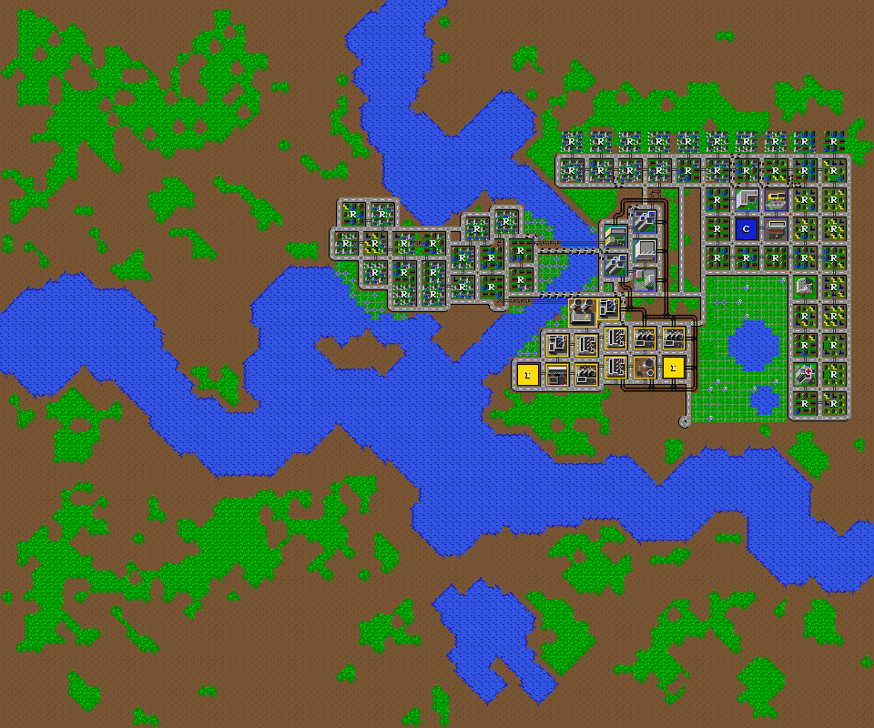
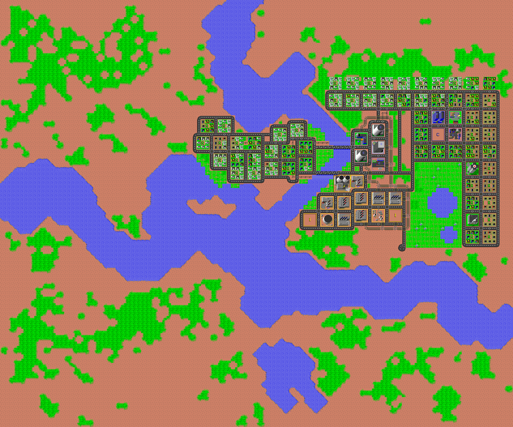

# amiga-simcity-printcity

Rendu en PNG des villes de **SimCity Amiga** (Maxis, 1989), comme le fait
l'utilitaire **PrintCity** fourni sur la disquette du jeu, mais en couleurs
et dans un fichier au lieu de l'imprimante.



## Utilisation

```sh
pip install pillow
python3 simcity_render.py giltown "San Francisco" -o cartes/                 # tuiles Micropolis fournies
python3 simcity_render.py giltown "San Francisco" -t SimData2 -o cartes/     # tuiles Amiga
python3 simcity_render.py giltown -t tiles.xpm --scale 2 -o cartes/          # autre planche
python3 simcity_render.py -t SimData2 --sheet tuiles.png                     # planche des tuiles
```

Les villes sont les fichiers de sauvegarde du jeu et les scénarios du
dossier `Scenarios/` de la disquette. Les fichiers `.cty` de Micropolis
(sans en-tête MacBinary) sont acceptés aussi.

Options :

- `-t`, `--tiles FICHIER` : fichier de tuiles, format détecté tout seul
  (par défaut les tuiles Micropolis de `tiles/micropolis/`) ;
- `-o DOSSIER` : dossier de sortie ;
- `--scale N` : agrandissement entier ;
- `--sheet PNG` : enregistre aussi la planche de toutes les tuiles.

## Fichiers de tuiles acceptés

Le format est reconnu au contenu du fichier :

| Fichier | Reconnu par | Tuiles | Image d'une ville |
|---|---|---|---|
| `SimData2` de la disquette Amiga (non fourni, © Maxis) | signature `D5 DB` | 8 × 8, 16 couleurs | 960 × 800 |
| Une image contenant les 960 tuiles en grille, lues ligne par ligne : `tiles.png` de Micropolis (16 × 60 tuiles), fourni | tuiles carrées qui tombent juste | 16 × 16 | 1920 × 1600 |
| Une image en une seule colonne : `tiles.xpm`, `tilesbw.xpm` (noir et blanc), `tilessm.xpm` de Micropolis | hauteur multiple de 960 | 16 × 16, ou 3 × 3 pour `tilessm` | 1920 × 1600, ou 360 × 300 |

Toute image que Pillow sait ouvrir convient (PNG, GIF, BMP…). Les `.xpm` de
Micropolis sont lus par le script lui-même, parce que Pillow décode mal leurs
couleurs sur 16 bits par composante. Dans une colonne, les tuiles sont
supposées carrées : la colonne de bourrage de `tilessm.xpm` (4 pixels de
large pour des tuiles de 3) est ignorée.

Les tuiles Micropolis viennent de [Micropolis](https://github.com/SimHacker/micropolis),
la version de SimCity publiée sous GPL. Elles ont la même numérotation que
celles de SimCity : une ville Amiga se rend telle quelle avec, sans la disquette.



## Licences

Les tuiles Micropolis (`tiles/micropolis/tiles.png`) sont sous GNU GPL v3
avec les conditions additionnelles d'Electronic Arts : voir
`tiles/micropolis/NOTICE.txt` et `tiles/micropolis/COPYING`.

## Comment fonctionne PrintCity

PrintCity n'a besoin que de `SimData2` et d'un fichier ville. Il colle les
tuiles de `SimData2` dans une image en mémoire, puis l'envoie à
`printer.device`. Ce script refait ce rendu directement.

### SimData2

| Octets | Contenu |
|---|---|
| 0–1 | magique `D5 DB` |
| 2–3 | `$0010` (16 couleurs) |
| 4–5 | `$03D0` |
| 6–7 | 0 |
| 8–39 | palette de 16 couleurs, mots Amiga RGB4 (`$0RGB`) |
| 40– | 960 tuiles de 32 octets |

Une tuile fait 8 × 8 pixels en 4 plans de bits, rangés plan après plan :
8 octets pour le plan 0, puis le plan 1, etc. Le bit de poids fort de
chaque octet est le pixel de gauche.

### Fichier ville

Le fichier est enveloppé au format **MacBinary** (le jeu vient du Mac) :

| Octets | Contenu |
|---|---|
| 0 | 0 |
| 1 | longueur du nom |
| 2– | nom de la ville |
| 65–72 | type `CITY`, créateur `MCRP` |
| 83–86 | taille des données : 27 120 |
| 128– | les données (27 120 octets), puis remplissage jusqu'à un multiple de 128 |

Dans les données, la carte occupe les **24 000 derniers octets** :
120 colonnes de 100 mots big-endian, rangées colonne par colonne.
Les 10 bits de poids faible de chaque mot donnent le numéro de tuile ;
les bits de poids fort sont des drapeaux du jeu (alimentation, etc.).

Attention à bien partir de la fin des données et non de la fin du
fichier : les 16 octets de remplissage MacBinary décaleraient la carte de
8 tuiles, et le haut de chaque colonne se retrouverait en bas de l'image.
